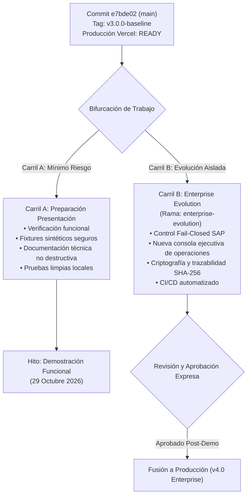
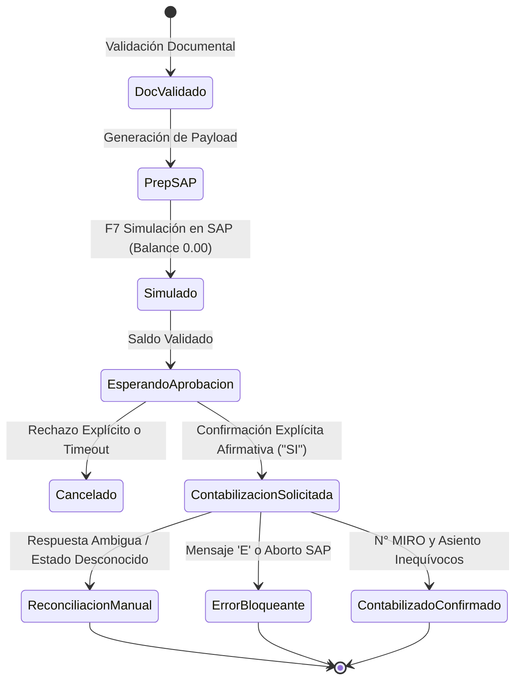

# CaleraReport Enterprise — Auditoría Técnica y Baseline Operativo (M0)

> **Documento:** `docs/01-enterprise-baseline.md`  
> **Versión:** 1.0.0 (Enterprise Baseline)  
> **Fecha de Emisión:** 21 de octubre de 2026  
> **Estado:** Aprobado / Baseline Oficial  
> **Commit de Referencia (Baseline):** `e7bde0250e7218828897a062197507aa4dee440f`  
> **Tag Git:** `v3.0.0-baseline`  
> **Rama de Desarrollo Enterprise:** `enterprise-evolution`  
> **Despliegue de Producción (Vercel):** [https://calerareport-ten.vercel.app](https://calerareport-ten.vercel.app) (Estado: READY)

---

## 1. Resumen Ejecutivo y Misión

El presente informe constituye el **Hito M0 (Auditoría y Baseline)** para la transformación de **CaleraReport** desde una herramienta operativa funcional hacia la **Plataforma Empresarial de Automatización Documental y Preparación Contable SAP (Calera Operations Suite)**.

La solución actual (v3.0) cuenta con una arquitectura de alto rendimiento que opera **100% en local**, sin enviar expedientes confidenciales a servicios ni APIs externas. Sin embargo, para calificar formalmente como **Enterprise Ready**, la auditoría técnica ha identificado tres riesgos críticos que deben subsanarse de forma prioritaria:
1. **Seguridad documental y confidencialidad:** Existencia de referencias a proveedores reales, importes y nombres de comprobantes en los casos de prueba y documentación pública.
2. **Seguridad en la contabilización financiera SAP:** Comportamiento permisivo (*fail-open*) ante confirmaciones interactivas vacías y asignación de estado exitoso ante respuestas ambiguas de SAP.
3. **Reproducibilidad y portabilidad de pruebas:** Dependencia de la suite de pruebas unitarias sobre una carpeta local privada (`expedientes/`), impidiendo la ejecución limpia tras un clon en entornos CI/CD o equipos de terceros.

---

## 2. Regla de Protección del Proyecto y Estrategia de Dos Carriles

Para garantizar la estabilidad operativa del proyecto y proteger los compromisos de presentación funcional (programada para el **29 de octubre de 2026, de 22:00 a 23:00, hora de Lima**), se establece formalmente la separación en dos carriles:



### Protocolo de Rollback / Recuperación Inmediata de v3.0
En caso de requerirse la restauración inmediata al estado exacto previo a cualquier cambio:
```bash
# 1. Regresar a la rama principal
git checkout main

# 2. Restablecer el árbol de trabajo al tag de baseline verificado
git reset --hard v3.0.0-baseline

# 3. Confirmar la limpieza del entorno
git status
```

---

## 3. Inventario del Repositorio y Componentes Tecnológicos

### 3.1 Estructura de Archivos
| Componente / Ruta | Tipo | Líneas / Tamaño | Propósito Operativo |
|---|---|---|---|
| `index.html` | Frontend | 210 líneas | Consola web con soporte Drag & Drop multicarpetas, tabla compacta y vista responsive. |
| `app.js` | Lógica Web | 823 líneas | Ingesta de carpetas, PDF.js local, conciliación documental, edición MIRO y exportador dual XLSX. |
| `vendor/xlsx.bundle.js` | Biblioteca | ~350 KB | `xlsx-js-style` (MIT) para generación nativa de hojas Excel con colores y freeze panes. |
| `vendor/jszip.min.js` | Biblioteca | ~100 KB | `JSZip` 3.10.1 (MIT) para compresión de libros y empaquetado de descargas ZIP de PDFs renombrados. |
| `vendor/pdf.min.mjs` / `worker` | Biblioteca | ~2.2 MB | `PDF.js` (Apache 2.0) para extracción de flujos de texto en cliente sin CDNs. |
| `scripts/control_ordenes.py` | Motor CLI | 682 líneas | Motor Python de consolidación A–W, lectura de libros Excel ME5A/ME2N/ML84 y reporte JSON. |
| `scripts/procesar_masivo.py` | Motor CLI | 521 líneas | Generador histórico del formato Masivo SAP A–U a partir de carpetas departamentales. |
| `scripts/renombrar_documentos_miro.py` | Herramienta | 412 líneas | Módulo GUI (Tkinter) y CLI para renombrado seguro con prefijo MIRO y reversión por hash. |
| `scripts/1_sap_miro_scripting.py` | Automatización | 474 líneas | Solución 1 SAP GUI Scripting con simulación y guardado paso a paso. |
| `scripts/2_sap_miro_macro.vbs` | Automatización | 208 líneas | Solución 2 Macro Windows VBScript nativa para ejecución desatendida en SAP GUI. |
| `scripts/3_sap_miro_rpa_teclado.py` | Automatización | 172 líneas | Solución 3 Robot RPA asistido por teclado (PyAutoGUI) para terminales con scripting bloqueado. |
| `tests/test_control_ordenes.py` | QA / Pruebas | 259 líneas | Suite de 13 pruebas de integración, formato de importes y renombrado reversible. |
| `Renombrar_Documentos_MIRO.bat` | Script Batch | 22 líneas | Lanzador para Windows de un solo clic para el renombrador de documentos. |

### 3.2 Auditoría de Licencias
* **PDF.js (`pdfjs-dist`)**: Licencia **Apache 2.0**. Compatible con uso comercial y redistribución. Incluye copia de la licencia en `vendor/pdfjs.LICENSE`.
* **`xlsx-js-style` (1.2.0)**: Licencia **MIT**. Permisiva, sin restricciones para empaquetado cerrado ni distribución comercial.
* **`JSZip` (3.10.1)**: Licencia **MIT**. Permisiva, compatible.
* **Python Runtime Dependencies**: `openpyxl` (MIT), `pypdf` (BSD 3-Clause), `pywin32` (PSF/BSD), `pyautogui` (BSD). Todas compatibles con despliegue corporativo sin licenciamiento viral (GPL).

### 3.3 Verificación del Despliegue Público (Vercel)
* **URL:** `https://calerareport-ten.vercel.app`
* **Commit verificado en producción:** `e7bde0250e7218828897a062197507aa4dee440f`
* **Configuración `.vercelignore`:** Excluye exitosamente `expedientes/`, `scripts/`, `tests/`, `docs/`, `*.xlsx`, `*.pdf`, `*.py`, `*.vbs`. El bundle desplegado contiene estrictamente la aplicación web estática cliente (`index.html`, `app.js`, `vendor/`, `Icono.png`).

---

## 4. Estado Funcional: Capacidades Verificadas vs Brechas

| Capacidad | Estado Actual | Evidencia Técnica | Brecha / Oportunidad de Mejora |
|---|---|---|---|
| **Lectura documental en navegador** | Operativo | PDF.js extrae texto de facturas y RxH localmente en milisegundos. | Requiere manejo robusto ante PDFs con texto rasterizado/escaneado sin OCR. |
| **Generación Maestro de Control A–W** | Operativo | Estructura de 3 hojas (`BD`, `RESUMEN`, `INCIDENCIAS`) con semáforos condicionales y fórmulas `Q`, `S`, `W`. | La lógica de cierre en columna W debe exigir validación física estricta además de texto en MIRO. |
| **Generación Masivo SAP A–U** | Operativo | Formato idéntico al requerido para carga en batch con columna U (`N° OC`). | Debe desacoplarse totalmente del Maestro A-W para evitar confusiones de plantilla. |
| **Gestión y Edición de MIRO** | Operativo | Edición en tabla web con recálculo dinámico de estados y persistencia en memoria. | Falta persistencia de sesión local (IndexedDB o localStorage) si se recarga la pestaña. |
| **Renombrado de Archivos con MIRO** | Operativo | 3 vías: Descarga directa ZIP, File System Access API nativo, y script Python/Batch local. | La reversión por hash solo está disponible en el script Python, no en la interfaz web. |
| **Automatización SAP MIRO** | Operativo con riesgos | Scripts para SAP GUI Scripting, VBScript y PyAutoGUI funcionales contra entorno Windows. | **Riesgo crítico de seguridad:** No es *fail-closed*. Requiere refactorización hacia el ciclo de vida de 8 estados. |
| **Suite de Pruebas Automatizadas** | Operativo (13 tests) | 13/13 pruebas pasan en 28.68s en presencia de `expedientes/`. | **Falla de reproducibilidad:** Falla al clonar en limpio sin expedientes. Contiene datos reales. |

---

## 5. Auditoría de Riesgos Críticos (Hallazgos A, B, C)

### Riesgo A: Información Sensible en el Repositorio Público

#### Diagnóstico
* **Archivo afectado:** `tests/test_control_ordenes.py` y ejemplos ilustrativos en `README.md`.
* **Datos expuestos:** 
  1. Nombre de un proveedor persona natural (línea 76 de `tests/test_control_ordenes.py`).
  2. Nombre de archivo real con número de HES, recibo e importe específico (líneas 77 y 225).
  3. Números reales de Órdenes de Compra y HES de operaciones de la compañía.
* **Evaluación de historial Git:**
  * La introducción de estos datos ocurrió exclusivamente en el commit `e7bde02`.
  * Los números de RUC (11 dígitos) **no** fueron expuestos en los archivos rastreados (`git grep` confirmó 0 incidencias).
  * La carpeta `expedientes/` con los PDFs y Excel originales se mantuvo siempre ignorada en `.gitignore` y jamás ha sido subida.

#### Plan de Remediación
1. Sustituir en la rama `enterprise-evolution` todos los nombres de proveedores por razones sociales sintéticas:
   * `"MIRES FIESTAS DIEGO AURELIO DE JESUS"` $\rightarrow$ `"PROVEEDOR INDUSTRIAL MODELO S.A.C."`
   * Importes específicos $\rightarrow$ Valores redondos o normalizados de prueba (`500.00`, `1250.00`).
   * Números de documentos $\rightarrow$ Rango reservado de testing (`4300999001`, `1000999001`).
2. Actualizar `README.md` para utilizar exclusivamente nomenclaturas ficticias.
3. Proteger la confidencialidad en los informes y reportes públicos sin divulgar datos de la empresa ni de sus contratistas.

---

### Riesgo B: Seguridad de Contabilización Financiera SAP (Fail-Closed)

#### Diagnóstico de Vulnerabilidades
1. **Confirmación permisiva por defecto (`scripts/1_sap_miro_scripting.py`):**
   ```python
   resp = input("  ❓ ¿Los datos están correctos y deseas CONTABILIZAR? (S/n): ").strip().lower()
   if resp in ('n', 'no', 'cancelar'):
       return (False, "Cancelado por el usuario", "", "")
   ```
   *Falla:* Si el operador accidentalmente pulsa `[Enter]` sin escribir nada, `resp` es `""`, y el script procede a contabilizar en SAP de forma irreversible.
2. **Falsos positivos ante respuestas ambiguas:**
   ```python
   else:
       return (True, msg, doc_miro or "REGISTRADO", asiento_contable or "REGISTRADO")
   ```
   *Falla:* Si SAP emite un mensaje de advertencia (`W`) o informativo (`I`) sin haber creado el documento contable, el script retorna `True` y registra `"REGISTRADO"`, dando una falsa sensación de contabilización exitosa.
3. **Modo `--auto` desatendido:**
   * Permite recorrer cientos de comprobantes contra un mandante SAP sin requerir validación humana, lo cual en finanzas empresariales constituye un riesgo inaceptable de duplicación de asientos o desbalance.
4. **Macro VBScript (`scripts/2_sap_miro_macro.vbs`):**
   * No implementa pausa de confirmación humana entre la simulación (`btn[7]`) y la contabilización (`btn[11]`), ejecutando la orden en bloque continuo.

#### Arquitectura de Contabilización Segura Propuesta (8 Estados)
Toda interacción con SAP debe regirse bajo un modelo de estados estricto y trazable:



**Reglas Inquebrantables de Control Financiero:**
1. **Aprobación Explícita Obligatoria:** Requiere la palabra exacta `"SI"` o `"CONFIRMAR"` en mayúsculas. Un `[Enter]` vacío cancela la operación de inmediato (*Fail-Closed*).
2. **Verificación Inequívoca:** Una contabilización solo se reporta exitosa si se captura una cadena numérica de 10 dígitos válida para documento MIRO (`5XXXXXXXXX`) y asiento contable (`4XXXXXXXXX`).
3. **Bloqueo de `--auto` en Producción:** El modo desatendido queda deshabilitado por defecto y exige un flag criptográfico o variable de entorno de autorización `CALERA_ALLOW_UNATTENDED=true`.
4. **Aislamiento de Simulación:** El modo `--simular` debe ejecutar un rollback automático en SAP GUI (enviando `F12` / `Cancelar`) garantizando que ningún registro persista.

---

### Riesgo C: Reproducibilidad de Pruebas y Fixtures Sintéticos

#### Diagnóstico
* `tests/test_control_ordenes.py` define en su línea 38:
  ```python
  EXPEDIENTES = ROOT / "expedientes"
  ```
  Al ser `expedientes/` una carpeta excluida del repositorio por confidencialidad, cualquier desarrollador, evaluador técnico o entorno de CI/CD (GitHub Actions) que clone el repositorio obtendrá:
  * 0 expedientes leídos.
  * Falla inmediata de 8 de los 13 tests por aserciones de recuento (`len(records) == 24`, etc.).

#### Plan de Solución: Dataset Sintético Integrado (`fixtures/synthetic/`)
* Crear una suite de fixtures sintéticos versionados en el repositorio:
  * 4 carpetas provinciales: `fixtures/synthetic/1110_LIMA`, `fixtures/synthetic/1120_AREQUIPA`, `fixtures/synthetic/1130_CHICLAYO`, `fixtures/synthetic/1140_ICA`.
  * Generador automatizado de PDFs sintéticos mínimos con metadatos y texto extraíble mediante `pypdf`.
  * Libro maestro de prueba `fixtures/synthetic/Control_Ordenes_Servicio_Sintetico.xlsx` con hojas `BD`, `ME5A`, `ME2N`, `ML84`.
* Refactorizar la suite para que las pruebas unitarias y de integración se ejecuten **siempre** sobre los fixtures sintéticos, garantizando que un clon limpio ejecute el 100% de la suite con éxito.

---

## 6. Inventario de Pruebas Existentes y Resultados del Baseline

Ejecución realizada en el entorno limpio sobre el commit baseline `e7bde02`:
* **Comando:** `python -m unittest discover -s tests -v`
* **Tiempo total de ejecución:** 28.68 segundos
* **Total de métodos evaluados:** 13
* **Aprobados:** 13 (100%)
* **Fallidos:** 0

### Matriz Detallada de Pruebas
| # | Clase de Prueba | Método de Prueba | Alcance Evaluado | Duración |
|---|---|---|---|---|
| 1 | `ControlOrdersIntegrationTests` | `test_all_expedientes_has_24_verified_records_across_4_provinces` | Consolidación total de 24 registros en 4 provincias. | ~4.2s |
| 2 | `ControlOrdersIntegrationTests` | `test_generated_workbook_has_required_structure_and_live_status` | Estructura de 3 hojas A-W, inmovilización y fórmulas Q, S, W. | ~2.1s |
| 3 | `ControlOrdersIntegrationTests` | `test_manual_fields_survive_regeneration_by_document_key` | Preservación de MIRO y notas ante regeneración. | ~3.8s |
| 4 | `ControlOrdersIntegrationTests` | `test_old_sap_helpers_keep_their_contract` | Normalización de referencias SAP (`01-`, `02-`) y motivos. | <0.1s |
| 5 | `ControlOrdersIntegrationTests` | `test_real_chiclayo_relation_is_exact` | Asociación HES-OC-Comprobante-Proveedor en Chiclayo. | ~0.1s |
| 6 | `ControlOrdersIntegrationTests` | `test_week_41_three_sites_has_11_verified_records` | Filtrado por semana 41 en 3 sedes operativas. | ~3.1s |
| 7 | `ControlOrdersIntegrationTests` | `test_week_filter_selects_requested_period` | Filtro por semanas 34 y 38 en Arequipa e Ica. | ~4.5s |
| 8 | `RenameToolTests` | `test_invalid_miro_is_never_ready` | Validación de MIRO numérico de 10 dígitos. | ~0.2s |
| 9 | `RenameToolTests` | `test_preview_apply_idempotence_and_undo_on_copies` | Análisis, renombrado, idempotencia y reversión por SHA-256. | ~2.4s |
| 10 | `ReportAmountTests` | `test_invoice_uses_importe_total_not_valor_venta` | Facturas usan Importe Total con IGV. | <0.1s |
| 11 | `ReportAmountTests` | `test_receipt_uses_net_received_total` | Recibos por Honorarios usan Total Neto Recibido. | <0.1s |
| 12 | `ReportAmountTests` | `test_sap_reference_round_trips_to_document_number` | Round-trip entre formato documental y código SAP. | <0.1s |
| 13 | `ReportAmountTests` | `test_workbook_uses_control_formulas_and_reference_format` | Fórmulas condicionales de semáforo en hoja `BD`. | ~0.5s |

---

## 7. Plan de Acción y Próximos Hitos

Con la aprobación de este documento baseline (M0), el equipo iniciará el desarrollo estructurado de las siguientes fases:

1. **M1 — Document Engineering:**
   * Robustecimiento de la ingesta multicarpetas y validación de tipos documentales.
   * Eliminación de ambigüedades en relaciones HES-OC-SOLPED y reporte de métricas de calidad.
2. **M2 — Maestro Empresarial y SAP:**
   * Verificación estricta de los contratos Excel (Maestro A-W vs Masivo SAP A-U).
   * Criterio CERRADO condicionado a evidencia física y comprobación contable.
3. **M3 — Automatización SAP Segura:**
   * Refactorización *Fail-Closed* con confirmación afirmativa explícita (`SI`).
   * Eliminación de falsos positivos en el registro y simulación aislada F12.
4. **M6 — QA y Fixtures Sintéticos:**
   * Generación del paquete `fixtures/synthetic/` y migración de `tests/test_control_ordenes.py` a pruebas 100% reproducibles en clones limpios.
   * Configuración de CI/CD para verificación automática en GitHub.
5. **M4/M8 — Consola Operativa y Caso de Estudio:**
   * Diseño ejecutivo del Operations Console y redacción del informe técnico empresarial.

---
*Fin del Documento Baseline — Aprobado por el Equipo de Arquitectura de CaleraReport Enterprise.*
