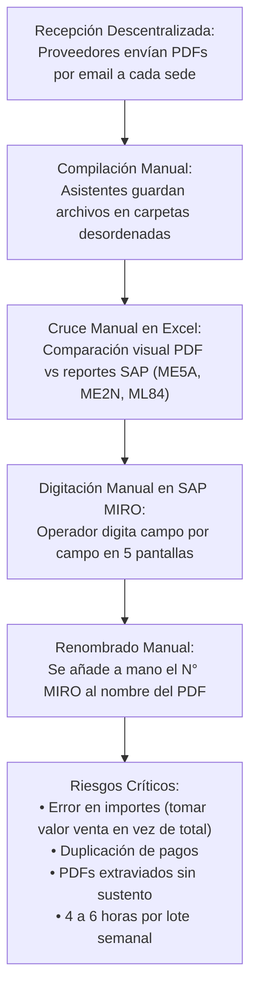
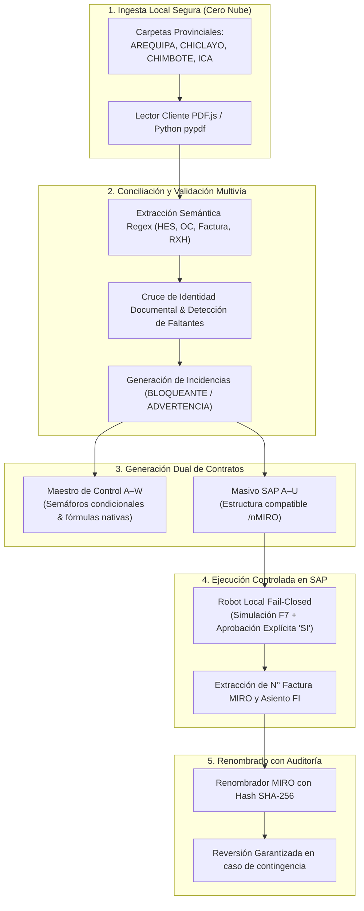

# CaleraReport Enterprise — Proceso de Negocio y Requerimientos

> **Documento:** `docs/02-business-process-and-requirements.md`  
> **Versión:** 1.0.0 (Enterprise Specification)  
> **Fecha:** 21 de octubre de 2026  
> **Estado:** Aprobado / Especificación Oficial  
> **Módulo:** Contexto Empresarial, Proceso As-Is vs To-Be y Requerimientos

---

## 1. Contexto Empresarial

**Sociedad Agrícola La Calera** (Sociedad SAP `1001`) es una de las empresas agroindustriales y avícolas líderes del Perú, con operaciones centrales en Chincha/Ica y centros de distribución y acopio en múltiples provincias del país (**Arequipa**, **Chiclayo**, **Chimbote**, **Ica**).

Para mantener su continuidad operativa semanal, la organización contrata cientos de servicios locales a terceros (saneo ambiental, mantenimiento de maquinaria, estiba portuaria, vigilancia, transporte y suministros eléctricos).

---

## 2. Diagnóstico del Proceso Inicial (Situación As-Is)

Antes de la implementación de CaleraReport, el flujo de pagos a contratistas presentaba serias ineficiencias operativas y riesgos financieros:

### Principales Puntos de Dolor Identificados:
1. **Dispersión Documental:** Archivos con nomenclaturas heterogéneas, espacios dobles, tildes y nombres incompletos de proveedores.
2. **Confusión en Importes Fiscales:** En facturas, operadores tomaban erróneamente el *Valor Venta* o multiplicaban por 1.18 en comprobantes inafectos. En Recibos por Honorarios, no se discriminaba la retención del 8% de 4ta categoría frente al neto recibido.
3. **Pérdida de Tiempo en SAP MIRO:** La digitación manual de 24 a 50 comprobantes por sede tomaba entre 4 y 6 horas hombre por semana, con alta propensión a errores tipográficos en el número de Orden de Compra o Referencia.
4. **Falta de Trazabilidad:** Si un documento cambiaba de nombre, no existía un registro histórico inmutable para revertir la operación en caso de auditoría interna.

---

## 3. Modelo Operativo Objetivo (Situación To-Be)

CaleraReport transforma este flujo en un ecosistema automatizado, seguro y auditable:

---

## 4. Requerimientos Funcionales y No Funcionales

### 4.1 Requerimientos Funcionales (RF)
* **RF-01 (Ingesta Multicarpetas):** El sistema debe permitir cargar lotes completos de carpetas departamentales en una sola operación o de forma acumulativa mediante Drag & Drop.
* **RF-02 (Parseo Fiscal Exacto):**
  - Facturas: Extraer obligatoriamente el Importe Total consignado (con IGV).
  - Recibos por Honorarios: Extraer el Total Neto Recibido.
* **RF-03 (Generación Maestro A–W):** Generar libro Excel con 3 hojas (`BD`, `RESUMEN`, `INCIDENCIAS`), inmovilización de paneles en `A2`, fórmulas nativas en columnas Q, S, W y formato condicional de 3 semáforos.
* **RF-04 (Generación Masivo SAP A–U):** Generar archivo de carga en batch para `/nMIRO` con 21 columnas y fila de totales sumatoria en columna Q.
* **RF-05 (Gestión Dinámica de MIRO):** Permitir la edición interactiva del código MIRO (10 dígitos) en tabla web con recálculo instantáneo de estados.
* **RF-06 (Renombrado Reversible):** Añadir el prefijo `{MIRO} - ` a los archivos PDF conservando bitácora inmutable con hash SHA-256 para permitir reversión total (*undo*).
* **RF-07 (Automatización SAP Fail-Closed):** Los bots de SAP deben simular primero (F7), verificar saldo 0.00 PEN y exigir confirmación afirmativa explícita (`SI`) antes de emitir la orden de contabilización (`Ctrl + S`).

### 4.2 Requerimientos No Funcionales (RNF)
* **RNF-01 (Privacidad Estricta / Zero-Cloud Leak):** Todo el procesamiento de texto y archivos debe realizarse estrictamente en memoria del cliente o en local. Queda prohibido enviar datos a servidores externos.
* **RNF-02 (Arquitectura Offline / Zero-CDN):** La aplicación web debe incluir todas sus bibliotecas (`pdf.js`, `xlsx`, `jszip`) de forma local en la carpeta `vendor/` para operar sin conexión a Internet.
* **RNF-03 (Reproducibilidad de Pruebas):** El repositorio debe incluir fixtures sintéticos 100% anonimizados que permitan ejecutar la suite de pruebas unitarias inmediatamente tras un clon limpio en Linux o Windows.
* **RNF-04 (Rendimiento):** El procesamiento de un lote completo de 4 provincias (70+ archivos PDF) debe completarse en menos de 5 segundos.
