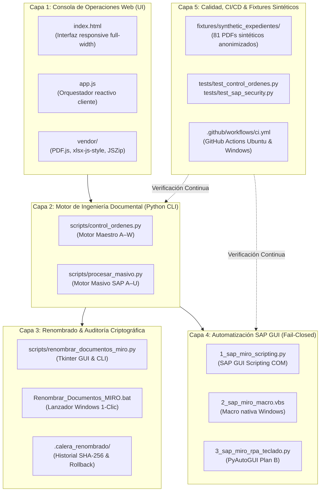

# CaleraReport Enterprise — Arquitectura del Sistema

> **Documento:** `docs/03-system-architecture.md`  
> **Versión:** 1.0.0 (Enterprise Specification)  
> **Fecha:** 21 de octubre de 2026  
> **Estado:** Aprobado / Especificación Oficial  
> **Módulo:** Arquitectura de Software, Descomposición en Capas y Seguridad

---

## 1. Principios de Diseño Arquitectónico

CaleraReport Enterprise se basa en tres principios de ingeniería fundamentales:

1. **Local-First & Cero Fuga de Datos (Zero-Cloud Leak):**  
   El procesamiento de comprobantes tributarios e importes comerciales se ejecuta íntegramente en la máquina del usuario (en el motor V8 del navegador o en el intérprete local de Python). Ningún byte viaja a servidores intermedios ni APIs de terceros.
2. **Independencia de Red (Zero-CDN Offline):**  
   Todas las bibliotecas críticas de frontend (`PDF.js`, `xlsx-js-style`, `JSZip`) están compiladas y versionadas localmente en `vendor/`. La aplicación funciona sin conexión a Internet o en intranets cerradas.
3. **Controles Financieros *Fail-Closed*:**  
   Ante cualquier anomalía, ambigüedad o falta de respuesta explícita del operador o de SAP, el sistema asume estado de fallo y aborta la transacción, impidiendo asientos contables duplicados o no respaldados.

---

## 2. Descomposición del Sistema en Capas

El ecosistema está estructurado en 5 capas desacopladas con responsabilidades estrictas:

---

## 3. Descripción de Capas

### Capa 1: Consola de Operaciones Web
* **Tecnología:** HTML5, CSS3 moderno con variables corporativas, JavaScript nativo ES2022.
* **Componentes:**
  - `Drag & Drop Zone`: Soporte de carpetas múltiples y lectura recursiva con File System Access API.
  - `Data Table`: Vista compacta responsive, filtros instantáneos por provincia/tipo/estatus y buscador contextual.
  - `Reactive MIRO Editor`: Entrada interactiva de 10 dígitos con recálculo dinámico del semáforo de estatus.
  - `Dual Exporter`: Generación en cliente de los libros `Control_Ordenes_Servicio.xlsx` (con XML de inmovilización de paneles y reglas de formato condicional) y `Masivo Reporte.xlsx`.

### Capa 2: Motor de Ingeniería Documental (CLI)
* **Tecnología:** Python 3.11+, `openpyxl`, `pypdf`.
* **Capacidades:**
  - Consolidación headless para pipelines desatendidos o ejecución en servidores batch.
  - Salida dual: JSON estructurado para integración (`--resumen-json`) y Excel enriquecido (`openpyxl`).
  - Recuperación de maestros editados (`--maestro-editado`) manteniendo la inmutabilidad de los datos históricos.

### Capa 3: Renombrado y Auditoría Criptográfica
* **Algoritmo de Reversibilidad:**
  1. Cada archivo a renombrar se analiza previamente verificando su ruta canónica (prevención de *Directory Traversal* y enlaces simbólicos).
  2. Se calcula el hash **SHA-256** del contenido original.
  3. Se registra la operación en una bitácora JSON (`historial_renombrado.json`).
  4. La función `Deshacer` verifica que el hash del archivo actual coincida con el hash original antes de revertir el nombre, impidiendo corrupción si el archivo fue modificado externamente.

### Capa 4: Automatización SAP GUI (Fail-Closed)
* **Modos de Ejecución:**
  - **Python Scripting COM:** Conexión a la sesión activa mediante `win32com.client`.
  - **VBScript Nativo:** Macro Windows sin dependencias de instalación externa.
  - **RPA Asistido por Teclado:** Automatización de eventos de pantalla y teclado con PyAutoGUI (Failsafe en esquina `(0,0)`).
* **Protocolo de Seguridad:**
  - Toda contabilización exige confirmación afirmativa explícita (`SI`).
  - Se verifica que la respuesta de SAP sea de tipo `S` (Éxito) o `I` (Informativo) y contenga un número MIRO (`5\d{9}`) o asiento contable (`4\d{9}`).
  - Prohibición de ejecuciones `--auto` desatendidas en producción sin autorización explícita.

### Capa 5: Calidad, CI/CD y Fixtures Sintéticos
* **Dataset Sintético:** Emula 24 expedientes en 4 provincias con razones sociales, RUCs y montos ficticios.
* **Pruebas Unitarias:** 21 pruebas automatizadas que cubren parseo, relaciones, idempotencia, fórmulas de Excel y seguridad SAP.
* **Pipeline GitHub Actions:** Verificación cruzada en entornos limpios Ubuntu y Windows sobre Python 3.11, 3.12 y 3.13.
