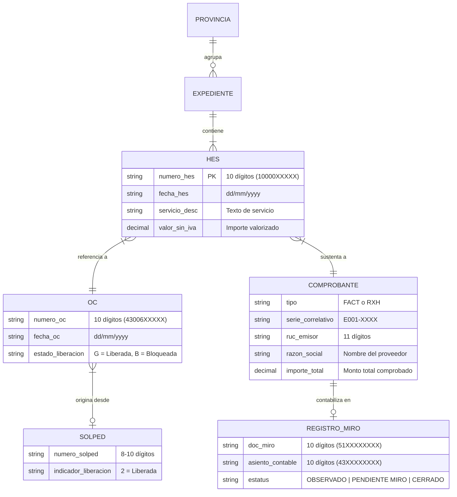
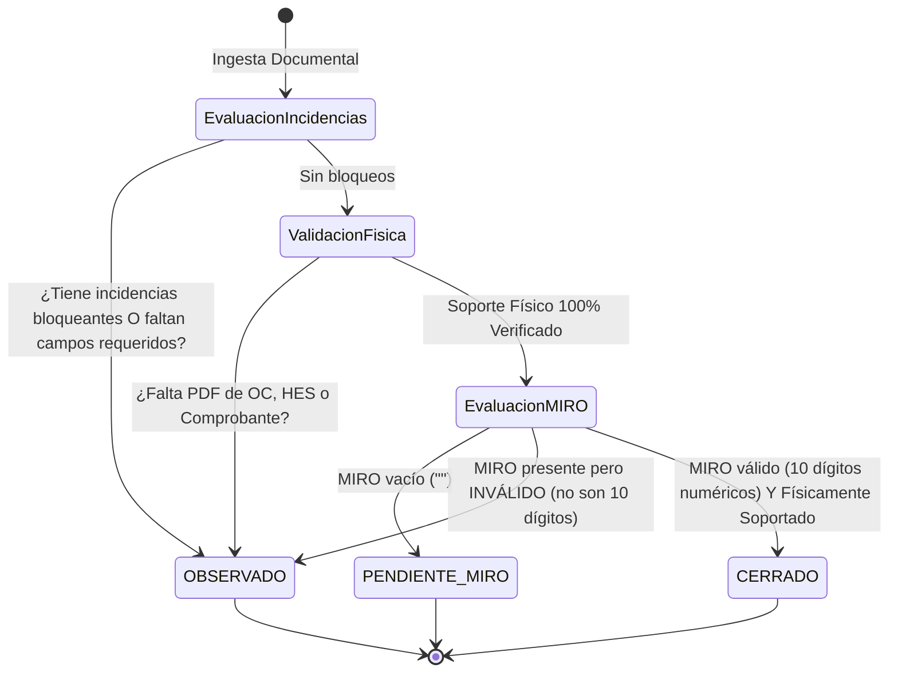

# CaleraReport Enterprise — Modelo de Datos Documental (M1)

> **Documento:** `docs/04-document-data-model.md`  
> **Versión:** 1.0.0 (Enterprise Specification)  
> **Fecha:** 21 de octubre de 2026  
> **Estado:** Aprobado / Especificación Oficial  
> **Módulo:** Ingesta, Conciliación y Modelado de Datos Documentales

---

## 1. Visión General del Dominio Documental

El sistema modela el ciclo de vida documental y financiero correspondiente a los servicios contratados por **La Calera** en sus distintas sedes operativas provinciales (Arequipa, Chiclayo, Chimbote, Ica).

Cada operación de pago a proveedores articula 5 entidades documentales heterogéneas:
1. **Hoja de Entrada de Servicios (HES):** Comprobante interno de recepción de servicio en SAP (Serie `10XXXXXXXX`). Es la **unidad fundamental de granularidad** del reporte.
2. **Orden de Compra / Servicio (OC):** Compromiso contractual generado en SAP (Serie `43XXXXXXXX`).
3. **Solicitud de Pedido (SOLPED):** Requerimiento inicial del área usuaria (Serie `100XXXXXXX` o `30XXXXXX`).
4. **Comprobante de Pago Electrónico:**
   - **Factura Electrónica:** Emitida por personas jurídicas con IGV (18%), serie `E001-XXXX` / `FXXX-XXXX`.
   - **Recibo por Honorarios Electrónico (RXH):** Emitido por personas naturales sin IGV (Serie `E001-XXXX`), sujeto o no a retención del 8% de Impuesto a la Renta de 4ta categoría.
5. **Registro Contable SAP MIRO:** Número de documento de factura comercial en SAP (Serie `51XXXXXXXX`) y su Asiento Contable FI asociado (Serie `43XXXXXXXX`).



---

## 2. Definición de Entidades y Campos Maestros (Columnas A–W)

La tabla base del Maestro de Control (`BD`) consolida 23 columnas normalizadas:

| Col | Encabezado Oficial | Nombre Interno | Tipo de Dato | Restricción / Formato | Regla de Negocio y Origen |
|:---:|---|---|:---:|---|---|
| **A** | `ID ` | `id` | Entero | Autoincremental (1..N) | Identificador secuencial de fila en el reporte consolidado. |
| **B** | `FECHA` | `fecha` | Fecha | `DD/MM/YYYY` | Fecha de emisión del comprobante. Fallback: fecha de HES/OC. |
| **C** | `SEM` | `sem` | Texto | `^\d{1,2}$` (ej. `41`) | Semana operativa calculada o extraída del expediente. |
| **D** | `Provincia ` | `provincia` | Texto | `AREQUIPA`, `CHICLAYO`, `CHIMBOTE`, `ICA` | Sede geográfica inferida de la carpeta raíz del lote. |
| **E** | `SOLICITANTE` | `solicitante` | Texto | Estándar: `ALMACEN` | Área responsable extraída de HES/ME5A. |
| **F** | `MOTIVO` | `motivo` | Texto | Longitud $\le 50$ | Tipo de servicio prestado (ej. `SERV. SANEO`, `SERV. ESTIBA`). |
| **G** | `SOLPED` | `solped` | Texto | `^\d{7,10}$` | Número de Solicitud de Pedido (opcional si no aplica). |
| **H** | `RUC` | `ruc` | Texto | `^\d{11}$` | RUC emisor validado con algoritmo de 11 dígitos SUNAT. Formato texto `@` para preservar ceros a la izquierda. |
| **I** | `NOMBRE DEL PROVEEDOR ` | `proveedor` | Texto | Mayúsculas limpias | Razón social o nombres y apellidos normalizados del emisor. |
| **J** | `TIPO DOC` | `tipo_doc` | Texto | `FACT` o `RXH` | Tipo de documento fiscal. |
| **K** | `N° Doc` | `documento` | Texto | `01-0E001-XXXXXXX` / `02-0E001-XXXXXXX` | Comprobante estructurado como Referencia Oficial SAP. |
| **L** | `VALORIZADO` | `valorizado` | Decimal | `#,##0.00` (2 decimales) | Factura: Importe Total con IGV. RXH: Total Neto Recibido. |
| **M** | `DETALLE SERVICIO` | `detalle` | Texto | Libre | Descripción extendida del trabajo reportado en la HES/OC. |
| **N** | `N° OC` | `oc` | Texto | `^\d{8,10}$` | Número de la Orden de Compra/Servicio SAP. |
| **O** | `N° HES` | `hes` | Texto | `^\d{8,10}$` | Número de la Hoja de Entrada de Servicios SAP. |
| **P** | `Lib Solped` | `lib_solped` | Texto | `2`, `0` o vacío | Código de liberación de la SOLPED en SAP. |
| **Q** | `¿Solped Liberada` | `solped_liberada` | Fórmula | `=IFERROR(IF(VALUE(P2)=2,2,0),0)` | Semáforo: `2` (Verde), `0` (Rojo). |
| **R** | `Lib OS` | `lib_os` | Texto | `G`, `B` o vacío | Código de liberación de la OS en SAP (`G` = Aprobado). |
| **S** | `¿OS Liberada?` | `os_liberada` | Fórmula | `=IF(R2="G",2,IF(R2="B",0,1))` | Semáforo: `2` (Verde), `1` (Amarillo), `0` (Rojo). |
| **T** | `OBSERVACIONES` | `observaciones` | Texto | Prefijos estandarizados | Trazabilidad de incidencias: `BLOQUEANTE: ...` o `ADVERTENCIA: ...`. |
| **U** | `MIRO` | `miro` | Texto | `^\d{10}$` | Código del registro MIRO en SAP. Obligatorio para cerrar. |
| **V** | `OBS. MIRO` | `obs_miro` | Texto | Libre | Comentarios del analista contable o validación de finanzas. |
| **W** | `ESTATUS` | `estatus` | Fórmula / Estado | `OBSERVADO` \| `PENDIENTE MIRO` \| `CERRADO` | Estado del expediente condicionado a reglas documentales. |

---

## 3. Claves de Identidad y Modelo de Conciliación

Para garantizar la idempotencia y evitar duplicidades al procesar lotes múltiples o regenerar maestros, se definen dos niveles de claves compuestas:

### 3.1 Clave de Grupo Documental (`document_group_key`)
Identifica el expediente contractual único:
$$\text{GroupKey} = (\text{sem}, \text{provincia}, \text{ruc}, \text{tipo\_doc}, \text{documento\_normalizado}, \text{oc}, \text{hes})$$
* **Propósito:** Se utiliza para migrar y recuperar notas manuales, observaciones y códigos MIRO ingresados previamente por los analistas. Si el mismo grupo documental contiene valores de MIRO contradictorios en un archivo previo, el motor **no adivina**: genera una incidencia bloqueante.

### 3.2 Clave de Fila Individual (`record_key`)
Identifica la línea específica de servicio dentro del documento:
$$\text{RecordKey} = (\text{GroupKey}, \text{motivo}, \text{valorizado})$$
* **Propósito:** Permite soportar facturas o recibos que contienen múltiples HES o servicios desglosados sin colisionar ni sobreescribirse.

---

## 4. Máquina de Estados del Expediente (`ESTATUS`)

El estado del expediente en la Columna W se rige por un autómata determinista:



### Reglas Rigurosas para la Condición `CERRADO`:
Un registro **solo y únicamente** puede tener estatus `CERRADO` si cumple concurrentemente con:
1. `_blocking.length == 0`: Ninguna incidencia bloqueante activa.
2. `_physical_supported == true`: Existencia inequívoca comprobada del PDF de HES, PDF de OC y PDF del comprobante.
3. `miro`: Cadena numérica exacta de 10 dígitos (`re.fullmatch(r"\d{10}", miro)`).
Cualquier incumplimiento degrada el estado a `OBSERVADO` o `PENDIENTE MIRO`.

---

## 5. Esquema de Incidencias y Auditoría

Cada desviación detectada se registra como un objeto `Incident` inmutable:

```python
@dataclass(frozen=True)
class Incident:
    week: str        # Semana operativa (ej. "41")
    province: str    # Sede (ej. "CHICLAYO")
    document: str    # N° comprobante (ej. "E001-41")
    source: str      # Archivo o fase de origen (ej. "HES 1000094356...")
    field: str       # Campo afectado (ej. "N° OC", "RUC", "VALORIZADO")
    severity: str    # "BLOQUEANTE" | "ADVERTENCIA" | "INFORMATIVA"
    reason: str      # Detalle técnico explicativo de la discrepancia
```

### Clasificación de Severidad:
* **`BLOQUEANTE`**: Impide que el expediente sea contabilizado o cerrado. (Ej. Varios PDFs candidatos para la misma OC, falta de comprobante, MIRO con formato erróneo).
* **`ADVERTENCIA`**: El expediente se conserva y exporta, pero deja constancia para revisión humana. (Ej. PDF sin capa de texto legible donde los datos provinieron de la nomenclatura del archivo; semana inferida por fecha).
* **`INFORMATIVA`**: Notas operativas y confirmación de trazabilidad.
