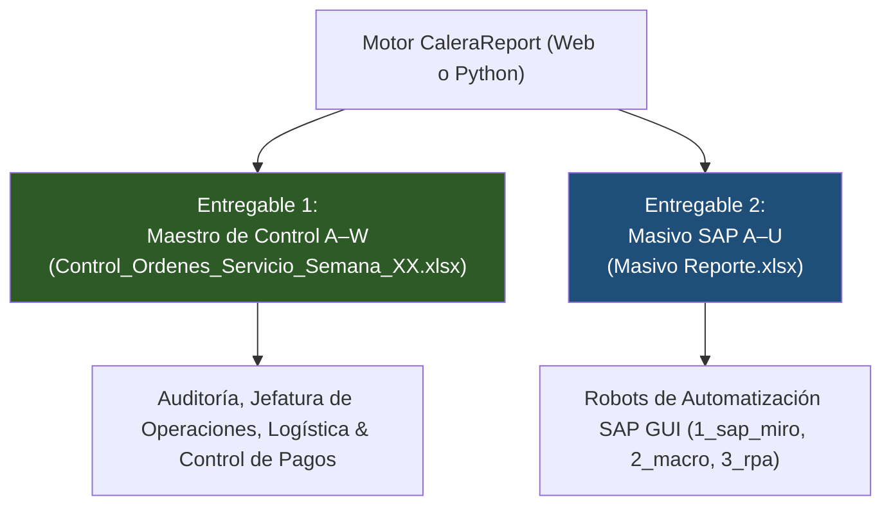

# CaleraReport Enterprise — Contratos de Salida Excel A–W y A–U (M2)

> **Documento:** `docs/06-excel-output-contracts.md`  
> **Versión:** 1.0.0 (Enterprise Specification)  
> **Fecha:** 21 de octubre de 2026  
> **Estado:** Aprobado / Especificación Oficial  
> **Módulo:** Especificación de Contratos de Generación Excel

---

## 1. Principio Fundamental de Segregación de Libros

El sistema genera de forma estrictamente separada e independiente **dos entregables Excel**, los cuales responden a audiencias, casos de uso y esquemas técnicos totalmente disjuntos:



> [!CAUTION]
> **Regla de Oro:** La Columna U tiene significados incompatibles entre ambos archivos:
> - En el **Maestro de Control A–W**, la **Columna U** es el código de registro **`MIRO`** (manual o recuperado).
> - En el **Masivo SAP A–U**, la **Columna U** es el **`N° OC`** (Orden de Compra).
> 
> Nunca deben fusionarse, intercambiarse ni usarse con las mismas plantillas de carga.

---

## 2. Contrato Técnico: Maestro de Control A–W

* **Nombre de Archivo:** `Control_Ordenes_Servicio_Semana_{SEMANA}_Generado.xlsx`
* **Estructura:** Exactamente tres (3) hojas de trabajo: `BD`, `RESUMEN` e `INCIDENCIAS`.

### 2.1 Hoja 1: `BD` (Base de Datos Consolidada)
* **Encabezados (Fila 1):** 23 columnas obligatorias desde A hasta W.
* **Inmovilización de Paneles:** Fila superior inmovilizada en celda `A2` (`<pane ySplit="1" topLeftCell="A2" activePane="bottomLeft" state="frozen"/>`).
* **Filtros Automáticos:** Rango `A1:W{N}` activo.

#### Mapeo Completo de Columnas:
| Columna | Nombre Oficial de Cabecera | Tipo de Dato Excel | Formato / Alineación | Regla Técnica / Fórmula Nativa |
|:---:|---|:---:|:---:|---|
| **A** | `ID ` | Entero | Centro | Secuencia correlativa $1, 2, 3 \dots$ |
| **B** | `FECHA` | Fecha | Centro (`DD/MM/YYYY`) | Fecha real serial de Excel. |
| **C** | `SEM` | Texto / Num | Centro | Semana operativa (ej. `41`). |
| **D** | `Provincia ` | Texto | Izquierda | Sede normalizada (`AREQUIPA`, `CHICLAYO`, `CHIMBOTE`, `ICA`). |
| **E** | `SOLICITANTE` | Texto | Izquierda | Unidad usuaria (`ALMACEN`). |
| **F** | `MOTIVO` | Texto | Izquierda | Servicio ejecutado (`SERV. SANEO`, `SERV. VIGILANCIA`). |
| **G** | `SOLPED` | Texto (`@`) | Centro | Número de SOLPED preservando ceros a la izquierda. |
| **H** | `RUC` | Texto (`@`) | Centro | RUC emisor de 11 dígitos. Obligatoriamente texto para no perder ceros. |
| **I** | `NOMBRE DEL PROVEEDOR ` | Texto | Izquierda | Denominación o Razón Social oficial. |
| **J** | `TIPO DOC` | Texto | Centro | `FACT` o `RXH`. |
| **K** | `N° Doc` | Texto | Centro | Referencia oficial SAP (`01-0E001-XXXXXXX` / `02-0E001-XXXXXXX`). |
| **L** | `VALORIZADO` | Numérico (`n`) | Derecha (`"S/ "#,##0.00`) | Importe total comprobado (Factura: Total con IGV; RXH: Neto Recibido). |
| **M** | `DETALLE SERVICIO` | Texto | Izquierda | Glosa detallada de la HES/OC. |
| **N** | `N° OC` | Texto (`@`) | Centro | Código SAP de la Orden de Compra (10 dígitos). |
| **O** | `N° HES` | Texto (`@`) | Centro | Código SAP de la Hoja de Entrada (10 dígitos). |
| **P** | `Lib Solped` | Texto | Centro | Código de liberación de SOLPED (`2`, `0` o vacío). |
| **Q** | `¿Solped Liberada` | Fórmula | Centro | **Fórmula Nativa:** `=IFERROR(IF(VALUE(P{row})=2,2,0),0)`<br>**Semáforo:** IconSet 3 Semáforos (`2`=Verde, `0`=Rojo). |
| **R** | `Lib OS` | Texto | Centro | Código de liberación de OS (`G`, `B` o vacío). |
| **S** | `¿OS Liberada?` | Fórmula | Centro | **Fórmula Nativa:** `=IF(R{row}="G",2,IF(R{row}="B",0,1))`<br>**Semáforo:** IconSet 3 Semáforos (`2`=Verde, `1`=Amarillo, `0`=Rojo). |
| **T** | `OBSERVACIONES` | Texto | Izquierda | Registro de auditoría e incidencias bloqueantes/advertencias. |
| **U** | `MIRO` | Texto (`@`) | Centro | **Código SAP MIRO ingresado por el usuario** (10 dígitos). |
| **V** | `OBS. MIRO` | Texto | Izquierda | Comentarios o notas de validación contable. |
| **W** | `ESTATUS` | Fórmula | Centro | **Fórmula Nativa:**<br>`=IF(OR(B{row}="",C{row}="",D{row}="",H{row}="",J{row}="",K{row}="",L{row}="",N{row}="",O{row}="",LEFT(T{row},10)="BLOQUEANTE"),"OBSERVADO",IF(U{row}="","PENDIENTE MIRO","CERRADO"))` |

#### Configuración de Reglas de Formato Condicional (Semáforos Nativos de Excel):
Para garantizar que Excel muestre los íconos circulares verde/rojo exactamente como en la plantilla original sin alterar la celda:
```xml
<conditionalFormatting sqref="Q2:Q{lastRow}">
  <cfRule type="iconSet" priority="1">
    <iconSet iconSet="3TrafficLights1" showValue="0">
      <cfvo type="num" val="0"/>
      <cfvo type="num" val="1"/>
      <cfvo type="num" val="2"/>
    </iconSet>
  </cfRule>
</conditionalFormatting>
<conditionalFormatting sqref="S2:S{lastRow}">
  <cfRule type="iconSet" priority="2">
    <iconSet iconSet="3TrafficLights1" showValue="0">
      <cfvo type="num" val="0"/>
      <cfvo type="num" val="1"/>
      <cfvo type="num" val="2"/>
    </iconSet>
  </cfRule>
</conditionalFormatting>
```

### 2.2 Hoja 2: `RESUMEN`
Matriz ejecutiva generada automáticamente con agregaciones tabulares:
* **Totales Generales:** Registros totales, volumen valorizado total en PEN, recuento de comprobantes físicos.
* **Desglose por Provincia:** Cantidad de expedientes e importe por sede (Arequipa, Chiclayo, Chimbote, Ica).
* **Distribución de Estatus:** Cantidad de registros en `OBSERVADO`, `PENDIENTE MIRO` y `CERRADO`.
* **Distribución Fiscal:** Recuento de Facturas (`FACT`) vs Recibos por Honorarios (`RXH`).

### 2.3 Hoja 3: `INCIDENCIAS`
Bitácora de auditoría detallada de cada excepción detectada:
* Columnas: `SEM`, `PROVINCIA`, `DOCUMENTO`, `FUENTE`, `CAMPO`, `GRAVEDAD`, `MOTIVO`.

---

## 3. Contrato Técnico: Masivo SAP A–U

* **Nombre de Archivo:** `Masivo Reporte.xlsx`
* **Destino:** Plantilla estricta de entrada para la transacción `/nMIRO` o `/nFB60` en SAP GUI.
* **Estructura:** 21 columnas en hoja única, con fila final de totales en columna Q.

### 3.1 Mapeo de Columnas (A–U):
| Col | Campo SAP | Encabezado Oficial | Formato | Valor / Regla |
|:---:|---|---|:---:|---|
| **A** | `BKPF-ID` | `ID CABC(1)` | Centro | Secuencia correlativa $1, 2, 3 \dots$ |
| **B** | `INVFO-BLDAT` | `Fecha Doc` | Centro | `DD.MM.YYYY` (Fecha del comprobante). |
| **C** | `INVFO-BUDAT` | `Fecha Contab` | Centro | `DD.MM.YYYY` (Misma fecha de documento). |
| **D** | `INVFO-XBLNR` | `REFERENCIA` | Centro | Referencia estructurada (`01-0...` o `02-0...`). |
| **E** | `BKPF-BUKRS` | `Sociedad` | Centro | Constante `1001` (Sociedad Agrícola La Calera). |
| **F** | `INVFO-LIFNR` | `RUC` | Centro | RUC del proveedor (11 dígitos). |
| **G** | `INVFO-BLART` | `Clase Doc` | Centro | `KR` (Factura acreedor) o `KH` (Recibo por Honorarios). |
| **H** | `INVFO-MWSKZ` | `Ind Impto` | Centro | `C1` (Factura con IGV 18%) o `C0` (RH Inafecto). |
| **I** | `BKPF-BKTXT` | `Texto Cabecera` | Izquierda | Servicio limpio (sin mención de semana, $\le 25$ chars). |
| **J** | `BSEG-BUZEI` | `N° Posicion` | Centro | `1` (Posición única). |
| **K** | `BSEG-SHKZG` | `Ind DC` | Centro | `S` (Debe / Débito). |
| **L** | `BSEG-SGTXT` | `Texto Posicion` | Izquierda | Descripción del servicio. |
| **M** | `BSEG-KOSTL` | `Centro Costo` | Centro | Centro de costo asignado según sede. |
| **N** | `BSEG-HKONT` | `Cuenta Mayor` | Centro | Cuenta contable de gasto de servicios. |
| **O** | `BSEG-GSBER` | `Division` | Centro | División operativa. |
| **P** | `INVFO-WAERS` | `Moneda` | Centro | Constante `PEN` (Soles peruanos). |
| **Q** | `INVFO-WRBTR` | `Importe MD` | Derecha (`"S/ "#,##0.00`) | **Importe total del comprobante**. |
| **R** | `BSEG-MWSKZ` | `Indicador Impuesto`| Centro | `C1` o `C0`. |
| **S** | `BSEG-ZTERM` | `Condicion Pago` | Centro | Condición de crédito acordada (ej. `C000`, `C030`). |
| **T** | `BSEG-ZFBDT` | `Vencimiento` | Centro | Fecha base de vencimiento. |
| **U** | `RM08M-EBELN` | `N° OC` | Centro | **Número de Orden de Compra SAP** (para vincular pedido). |

### 3.2 Fila de Totales y AutoFiltro
* La fila $N+1$ cierra la tabla con fondo verde institucional (`#375623`), texto en blanco, etiqueta `'TOTAL'` en columna A, y fórmula aritmética de cuadre en Columna Q:
  $$=\text{SUM}(Q2:Q{N})$$
* **Filtro automático:** `A1:U{N}`.
