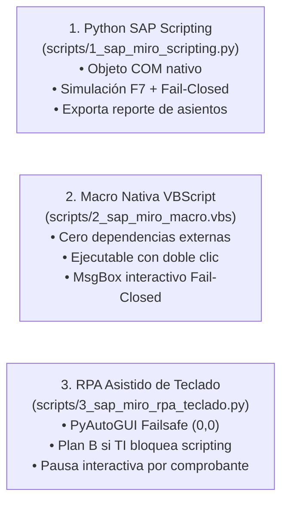
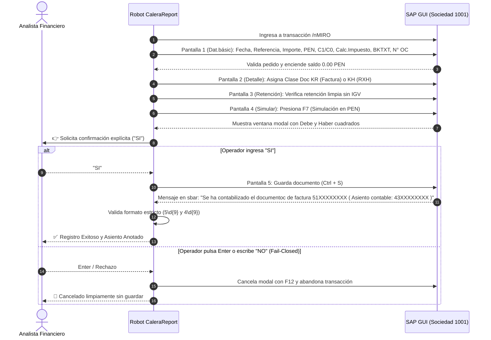

# CaleraReport Enterprise — Integración SAP MIRO y Controles Financieros (M3)

> **Documento:** `docs/07-sap-integration-and-controls.md`  
> **Versión:** 1.0.0 (Enterprise Specification)  
> **Fecha:** 21 de octubre de 2026  
> **Estado:** Aprobado / Especificación Oficial  
> **Módulo:** Automatización SAP GUI, Controles Fail-Closed y Trazabilidad Contable

---

## 1. Arquitectura de Integración SAP

La integración con SAP ERP (transacciones `/nMIRO` y `/nFB60`) está diseñada como un conjunto de componentes **estrictamente locales para Windows**, operando bajo el contexto de seguridad del usuario autenticado en SAP Logon.

> [!IMPORTANT]
> **Aislamiento de Producción:** La aplicación web estática desplegada en Vercel **no ejecuta ni se conecta a SAP directamente**. Toda interacción con el ERP requiere SAP GUI for Windows y se ejecuta mediante los scripts auditados en `scripts/`.

### Las 3 Soluciones Locales Llave en Mano:


---

## 2. Flujo Oficial en SAP MIRO (5 Pantallas de Control)

Cada comprobante del archivo `Masivo Reporte.xlsx` se procesa ejecutando el recorrido oficial de 5 pantallas:



---

## 3. Matriz de Mapeo de Campos SAP MIRO

| Parámetro SAP | Identificador Interno GUI | Origen en `Masivo Reporte.xlsx` | Regla Técnica de Asignación |
|---|---|---|---|
| **Fecha factura** | `INVFO-BLDAT` | Columna B (`Fecha Doc`) | `DD.MM.YYYY` (Fecha de emisión). |
| **Fecha contab.** | `INVFO-BUDAT` | Columna C (`Fecha Contab`) | `DD.MM.YYYY` (Misma fecha del documento). |
| **Referencia** | `INVFO-XBLNR` | Columna D (`REFERENCIA`) | `01-0...` (Factura) o `02-0...` (Recibo por Honorarios). |
| **Importe Total** | `INVFO-WRBTR` | Columna Q (`Importe MD`) | Monto con 2 decimales (**Total con IGV** para Factura; Neto para RH). |
| **Moneda** | `INVFO-WAERS` | Columna P (`Moneda`) | Constante `PEN`. Asignación vía `.text` o `.key = "PEN"`. |
| **Indicador Imp.** | `INVFO-MWSKZ` | Columna H (`Ind Impto`) | `.key = "C1"` (Factura 18%) o `.key = "C0"` (RH Inafecto). |
| **Calc. Impuestos**| `INVFO-XMWST` | Derivado de Columna H | `Selected = True` si es `C1`; `False` si es `C0`. |
| **Texto Cabecera** | `INVFO-BKTXT` | Columna I / L | Servicio limpio filtrando `"SEMANA"` ($\le 25$ caracteres). |
| **Pedido Entregas**| `RM08M-EBELN` | Columna U (`N° OC`) | Envía número de OC y ejecuta `sendVKey 0` (Enter). |
| **Clase Documento**| `INVFO-BLART` | Columna G (`Clase Doc`) | Pestaña Detalle: `KR` para Facturas, `KH` para RH. |

---

## 4. Política de Seguridad Financiera Fail-Closed

Para mitigar riesgos de duplicación de pagos o desbalances contables, se implementaron 4 salvaguardas no negociables:

### 1. Confirmación Humana Afirmativa Obligatoria
* En consola interactiva:
  ```text
  👉 Revisa la ventana de simulación en tu SAP GUI (Saldo debe ser 0.00 PEN).
  ❓ ¿Deseas CONTABILIZAR este comprobante en SAP? Escribe 'SI' para confirmar:
  ```
* Si el operador presiona `[Enter]` sin escribir nada o ingresa cualquier texto distinto a `"SI"` o `"CONFIRMAR"`, la operación se **aborta de inmediato**, enviando la tecla `F12` a SAP GUI para descartar la simulación sin modificar la base de datos.

### 2. Prohibición de Falsos Positivos
* Una contabilización solo se marca como exitosa si y solo si la barra de mensajes de SAP (`sbar`) devuelve un tipo de mensaje `S` (Éxito) o `I` (Informativo) y la expresión regular captura:
  - Documento Factura MIRO: `re.search(r'\b(5\d{9})\b', msg)`
  - Asiento Contable FI: `re.search(r'\b(4\d{9})\b', msg)`
* Cualquier respuesta ambigua, advertencia (`W`) o código no reconocido **impide marcar el comprobante como registrado** y lo envía a la cola de reconciliación manual.

### 3. Bloqueo del Modo Desatendido (`--auto`)
* La ejecución de `--auto` queda bloqueada en entornos operacionales estándar.
* Para habilitarlo en entornos de pruebas automatizadas o autorización expresa de finanzas, se requiere:
  ```powershell
  # Opción 1: Variable de entorno
  $env:CALERA_ALLOW_UNATTENDED = "true"
  python scripts/1_sap_miro_scripting.py --auto

  # Opción 2: Parámetro explícito de auditoría
  python scripts/1_sap_miro_scripting.py --auto --forzar-auto-autorizado
  ```

### 4. Aislamiento Limpio en Modo Simulación (`--simular`)
* Permite validar en vivo que los datos digitados enciendan el semáforo verde de SAP con saldo `0.00 PEN`.
* Al presionar simular, el bot captura los balances, envía la tecla `F12` (Cancelar) al cuadro modal y nuevamente `F12` a la pantalla principal, dejando la sesión de SAP GUI en estado limpio (*Stateless*).

---

## 5. Reporte Independiente de Asientos Contables

Tras concluir el proceso, el robot genera el libro independiente:
**`Reporte_Asientos_Contables_SAP.xlsx`**

Conformado por 13 columnas de auditoría:
1. `Fila Excel`
2. `Fecha Doc`
3. `Referencia`
4. `RUC`
5. `Proveedor`
6. `Orden de Compra (OC)`
7. `Texto Posición`
8. `Importe Total (PEN)`
9. `Ind Impto`
10. `N° Factura MIRO` (`5XXXXXXXXX`)
11. `Asiento Contable FI` (`4XXXXXXXXX`)
12. `Estado Contabilización` (`CONTABILIZADO`, `SIMULADO`, `CANCELADO`, `ERROR`)
13. `Mensaje SAP / Auditoría`
