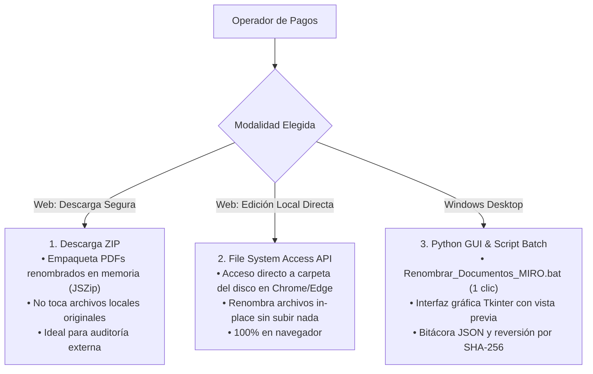

# CaleraReport Enterprise — Renombrado Seguro y Reversibilidad (M3/M4)

> **Documento:** `docs/08-document-rename-and-rollback.md`  
> **Versión:** 1.0.0 (Enterprise Specification)  
> **Fecha:** 21 de octubre de 2026  
> **Estado:** Aprobado / Especificación Oficial  
> **Módulo:** Motor de Renombrado Documental, Criptografía SHA-256 y Rollback

---

## 1. Justificación y Propósito Operativo

Una vez contabilizada la provisión en SAP MIRO, el estándar contable de **La Calera** exige que cada expediente digital en PDF lleve como prefijo el número de Documento MIRO de 10 dígitos generado por el sistema:

$$\text{Nombre Original: } \texttt{HES 1000094356 - RXH E001-41 - PROVEEDOR MODELO S.A.C..pdf}$$
$$\Downarrow$$
$$\text{Nombre Final: } \mathbf{5105773695} \texttt{ - HES 1000094356 - RXH E001-41 - PROVEEDOR MODELO S.A.C..pdf}$$

Este proceso manual de renombrado consumía horas al personal administrativo y generaba errores de asociación. CaleraReport automatiza esta tarea garantizando **seguridad criptográfica, prevención de colisiones e idempotencia total**.

---

## 2. Las 3 Modalidades de Renombrado



---

## 3. Arquitectura de Seguridad del Renombrado

### 3.1 Separación Estricta de Fases
El motor divide la operación en dos fases atómicas:
1. **Fase de Análisis (`analyze_renames`):** Escanea el archivo maestro y las carpetas físicas sin realizar ninguna modificación en el disco. Evalúa la validez del MIRO, la existencia física y posibles colisiones. Asigna estados deterministas: `LISTO`, `YA RENOMBRADO`, `MIRO INVÁLIDO`, `DESTINO EXISTENTE` o `NO ENCONTRADO`.
2. **Fase de Aplicación (`apply_renames`):** Solo procesa aquellos candidatos cuyo estado sea estrictamente `LISTO`.

### 3.2 Controles de Protección del Sistema de Archivos
* **Resolución Canónica de Rutas:** Se valida que cada archivo a renombrar se encuentre estrictamente dentro del árbol del directorio raíz autorizado (`os.path.commonpath`), previniendo vulnerabilidades de *Directory Traversal* (`../`).
* **Bloqueo de Enlaces Simbólicos:** Se rechazan enlaces simbólicos (`os.path.islink`) para evitar escrituras accidentales en rutas del sistema.
* **Prevención de Sobrescritura:** Si el archivo de destino ya existe físicamente en el disco, la operación se bloquea.
* **Idempotencia:** Si el script se ejecuta por segunda vez, detecta que el archivo ya cuenta con el prefijo MIRO exacto y retorna `YA RENOMBRADO`, impidiendo prefijos duplicados (ej. `5105... - 5105... - HES...`).

---

## 4. Trazabilidad Criptográfica SHA-256 y Mecanismo de Reversión (Undo)

Para brindar total tranquilidad en auditorías contables, cada lote aplicado genera un registro inmutable en `.calera_renombrado/historial_renombrado.json`:

```json
{
  "timestamp": "2026-10-21T10:30:00Z",
  "master_path": "Control_Ordenes_Servicio_Semana_41_Generado.xlsx",
  "scope": "hes",
  "entries": [
    {
      "original_path": "1130_CHICLAYO/HES 1000094356 - RXH E001-41 - PROVEEDOR.pdf",
      "new_path": "1130_CHICLAYO/5105773695 - HES 1000094356 - RXH E001-41 - PROVEEDOR.pdf",
      "sha256": "8f4a7c1b...b6e3f2",
      "size_bytes": 142050,
      "status": "RENOMBRADO"
    }
  ]
}
```

### Protocolo de Deshacer (Reversión Garantizada):
Cuando el usuario pulsa **"Deshacer último renombrado"**:
1. El motor lee la última transacción registrada en la bitácora.
2. Localiza el archivo renombrado en disco.
3. **Comprobación de Integridad:** Calcula el hash SHA-256 del archivo en ese instante y lo compara con el `sha256` original almacenado en la bitácora:
   - Si los hashes coinciden $\rightarrow$ Restaura el nombre original de forma segura.
   - Si los hashes difieren (el archivo fue editado o reemplazado externamente) $\rightarrow$ **Aborta la reversión** para evitar corrupción de datos y notifica al operador.
