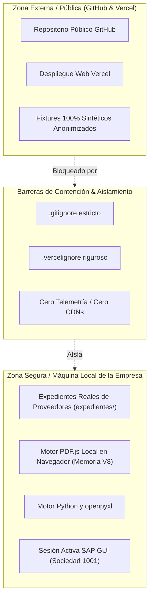

# CaleraReport Enterprise — Seguridad y Privacidad de Datos

> **Documento:** `docs/09-security-and-privacy.md`  
> **Versión:** 1.0.0 (Enterprise Specification)  
> **Fecha:** 21 de octubre de 2026  
> **Estado:** Aprobado / Especificación Oficial  
> **Módulo:** Modelo de Amenazas, Privacidad Financiera y Cumplimiento Normativo

---

## 1. Modelo de Amenazas y Postura de Seguridad

CaleraReport procesa información tributaria, financiera y comercial de alta confidencialidad (comprobantes de pago electrónicos, RUCs de proveedores personas naturales y jurídicas, importes de facturación, órdenes de compra internas y números de asiento contable de SAP).

La arquitectura asume un **modelo de confianza cero hacia servicios externos**, protegiendo los datos en reposo, en tránsito y durante su procesamiento.

---

## 2. Los 4 Niveles de Defensa en Profundidad

### Nivel 1: Control de Versionado y Repositorio Git
* La carpeta `expedientes/` que contiene las facturas, recibos y hojas de entrada originales de la empresa se encuentra permanentemente excluida mediante `.gitignore`.
* Los archivos Excel generados (`Masivo Reporte*.xlsx`, `Control_Ordenes_Servicio_*.xlsx`) y bitácoras locales (`.calera_renombrado/`) están estrictamente ignorados.
* El código fuente versionado, la suite de pruebas y la documentación pública utilizan exclusivamente **fixtures sintéticos** y razones sociales ficticias (ej. `PROVEEDOR MODELO S.A.C.`).

### Nivel 2: Aislamiento del Despliegue en la Nube (Vercel)
* El archivo `.vercelignore` garantiza que el sitio público desplegado en Vercel contenga **únicamente la interfaz gráfica estática de cliente** (`index.html`, `app.js`, `vendor/` e `Icono.png`).
* Se bloquea la subida de scripts de Python, macros VBScript, pruebas unitarias, documentos de diseño interno y cualquier archivo `.xlsx` o `.pdf`.

### Nivel 3: Ejecución en Tiempo de Ejecución (Client-Side Memory Only)
* Toda extracción de texto, cálculo de fórmulas y renderizado de tablas en la aplicación web se ejecuta en la memoria volátil del navegador del usuario.
* El bundle web utiliza copias locales de `pdf.min.mjs` y `xlsx.bundle.js` en `vendor/`. No existen llamadas de red salientes (`fetch`, `XMLHttpRequest`) hacia ningún servidor durante la operación de procesamiento.

### Nivel 4: Controles Financieros *Fail-Closed* para SAP
* Ninguna contabilización contable en SAP se efectúa de forma ciega o desatendida.
* Toda operación financiera requiere confirmación humana afirmativa explícita (`"SI"`), validación de saldos en `0.00 PEN` y comprobación inequívoca de números de documento generados por SAP.

---

## 3. Cumplimiento Normativo (Ley N° 29733 - Perú)

En observancia de la **Ley de Protección de Datos Personales del Perú (Ley N° 29733)** y su reglamento:
1. **Anonimización en Portafolio y Demostraciones Públicas:** Ningún RUC de persona natural, nombre propio de contratista ni comprobante real emitido por terceros se publica en repositorios o portafolios abiertos.
2. **Propiedad Intelectual y Confidencialidad Corporativa:** El proyecto se documenta y presenta como un **caso de estudio profesional de ingeniería de software y automatización de procesos**, sin divulgar secretos comerciales ni operar contra sistemas productivos fuera de los protocolos autorizados por la organización.
