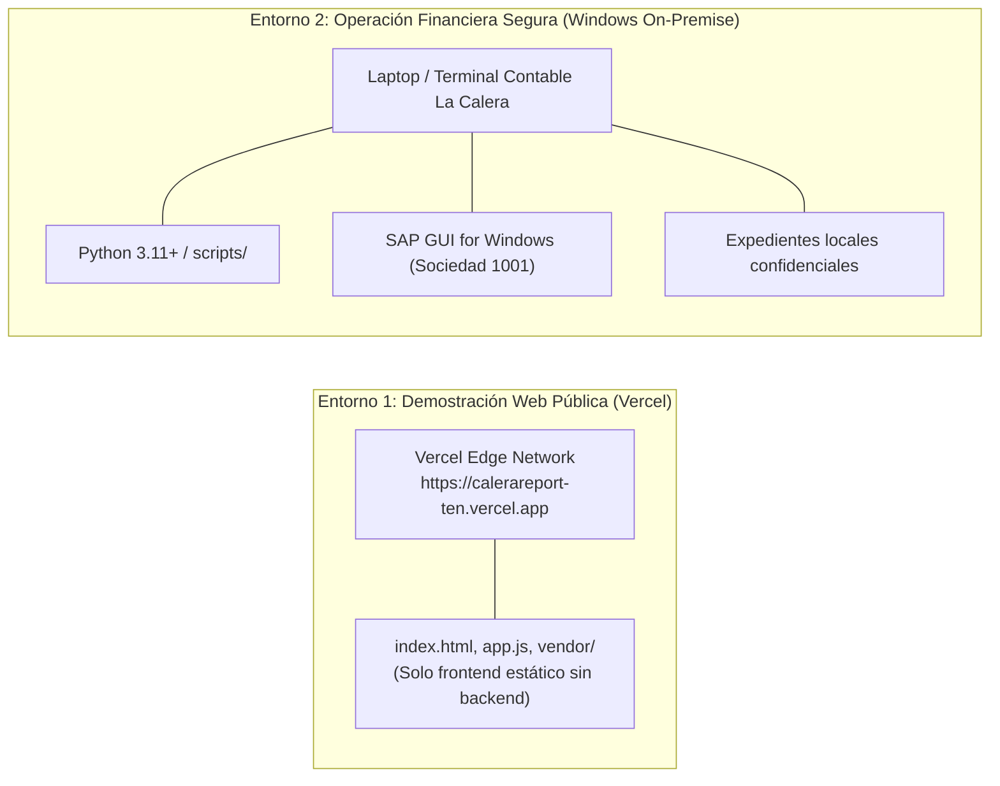

# CaleraReport Enterprise — Despliegue y Operaciones (SOP)

> **Documento:** `docs/11-deployment-and-operations.md`  
> **Versión:** 1.0.0 (Enterprise Specification)  
> **Fecha:** 21 de octubre de 2026  
> **Estado:** Aprobado / Procedimiento Operativo Estándar (SOP)  
> **Módulo:** Guía de Despliegue, Operación Semanal y Recuperación ante Desastres

---

## 1. Topología de Despliegue

CaleraReport opera bajo un esquema híbrido de dos entornos claramente segregados:



---

## 2. Guía de Despliegue Web en Vercel

1. **Configuración de Despliegue:**
   - La raíz del proyecto se compila como un sitio web puramente estático (`vercel.json` con `{"cleanUrls": true}`).
2. **Protección mediante `.vercelignore`:**
   - El archivo [.vercelignore](file:///c:/Users/Luis%20Romero/Documents/Proyectos/Calera/.vercelignore) excluye de la compilación todas las rutas con lógica de backend o datos sensibles:
     ```ignore
     expedientes/
     docs/
     scripts/
     tests/
     *.xlsx
     *.pdf
     *.py
     *.vbs
     ```
3. **Ejecución Local de la Web (Alternativa sin Internet):**
   ```powershell
   python -m http.server 8000
   # Abrir en navegador: http://localhost:8000
   ```

---

## 3. Procedimiento Operativo Estándar (SOP Semanal)

Este es el procedimiento paso a paso que debe seguir el analista contable cada semana:

### Fase 1: Ingesta y Generación del Maestro (Lunes 09:00 - 10:00)
1. Abrir la consola web de CaleraReport (`http://localhost:8000` o la aplicación local).
2. Arrastrar la carpeta raíz con las sedes de la semana (`1110_AREQUIPA`, `1130_CHICLAYO`, `1140_CHIMBOTE`, `1180_ICA`).
3. El sistema procesa los PDFs en 3 segundos y muestra el semáforo y la tabla de resumen.
4. Revisar la hoja **`INCIDENCIAS`**: Si existen registros en rojo (`BLOQUEANTE`), solicitar a operaciones el comprobante faltante o la corrección de la OC.
5. Descargar el libro **`Control_Ordenes_Servicio_Semana_XX.xlsx`** y el archivo **`Masivo Reporte.xlsx`**.

### Fase 2: Registro Contable en SAP MIRO (Lunes 10:30 - 11:30)
1. Iniciar sesión en **SAP GUI** en el mandante de producción de **Sociedad 1001**.
2. Abrir una consola PowerShell en la carpeta del proyecto y verificar en modo simulación:
   ```powershell
   python scripts/1_sap_miro_scripting.py --simular
   ```
   *Verificar que todos los documentos cuadren a saldo `0.00 PEN` sin generar asientos.*
3. Ejecutar el robot interactivo con control *Fail-Closed*:
   ```powershell
   python scripts/1_sap_miro_scripting.py
   ```
4. El robot digitará cada comprobante en SAP y solicitará confirmación afirmativa:
   - Revisar visualmente la ventana de SAP GUI.
   - Escribir `"SI"` para contabilizar.
   - SAP emitirá el número de factura MIRO (`51XXXXXXXX`) y el asiento contable FI (`43XXXXXXXX`).
5. Al finalizar, el script genera el archivo **`Reporte_Asientos_Contables_SAP.xlsx`**.

### Fase 3: Renombrado de Expedientes Digitales (Lunes 11:45)
1. Ejecutar el lanzador rápido de Windows:
   - Doble clic en [Renombrar_Documentos_MIRO.bat](file:///c:/Users/Luis%20Romero/Documents/Proyectos/Calera/Renombrar_Documentos_MIRO.bat).
2. Se abrirá la herramienta gráfica:
   - Seleccionar el archivo `Reporte_Asientos_Contables_SAP.xlsx` o el Maestro generado.
   - Seleccionar la carpeta de expedientes.
   - Pulsar **"Analizar MIRO"** $\rightarrow$ Confirmar que el estado sea `LISTO`.
   - Pulsar **"Renombrar documentos"** $\rightarrow$ Se añadirá el prefijo `51XXXXXXXX - ` a cada PDF.
3. Se genera la bitácora criptográfica en `.calera_renombrado/historial_renombrado.json`.

---

## 4. Procedimiento de Rollback y Recuperación ante Desastres

### Caso A: Reversión de Nombres de Archivo PDF
Si se detecta un error de digitación o asignación de MIRO tras haber renombrado la carpeta:
1. Abrir la herramienta ejecutando `Renombrar_Documentos_MIRO.bat`.
2. Hacer clic en el botón **"Deshacer último renombrado"**.
3. El sistema verificará el hash **SHA-256** de cada archivo contra la bitácora y restaurará los nombres originales en menos de 1 segundo.

### Caso B: Rollback Inmediato del Código a la Versión Estable v3.0
En caso de requerirse restaurar el código de forma idéntica al estado previo a cualquier cambio evolutivo:
```powershell
# 1. Regresar a la rama principal de producción
git checkout main

# 2. Restablecer el árbol de trabajo al tag verificado
git reset --hard v3.0.0-baseline

# 3. Validar estado limpio
git status
```
