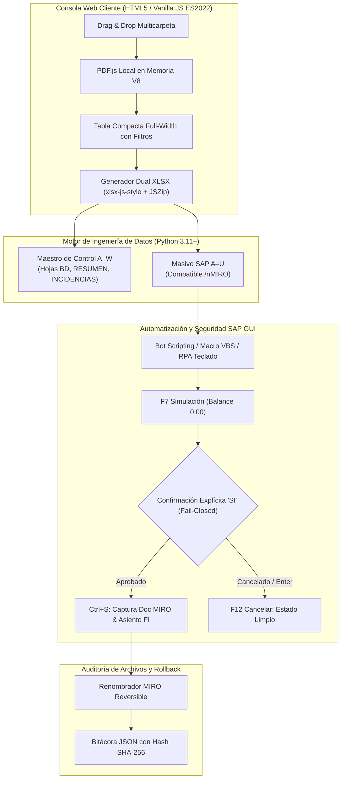

# CaleraReport — Enterprise Document Automation & SAP Integration Case Study

> **Estudio de Caso Profesional:** Ingeniería de Datos, Automatización Documental y Control Financiero SAP  
> **Organización de Referencia:** Sociedad Agrícola La Calera (Sociedad SAP 1001)  
> **Autor / Líder Técnico:** Luis Romero  
> **Fecha de Publicación:** 21 de octubre de 2026  
> **Estado:** Enterprise Ready / Versión Oficial para Portafolio

---

## 1. Resumen Ejecutivo

**CaleraReport Enterprise** es una plataforma integral de ingeniería documental y preparación contable diseñada para automatizar la conciliación masiva, validación tributaria y contabilización de pagos a proveedores de **Sociedad Agrícola La Calera** en sus 4 sedes operativas descentralizadas (**Arequipa**, **Chiclayo**, **Chimbote** e **Ica**).

La solución reemplaza un proceso manual fragmentado de 4 a 6 horas semanales por un pipeline determinista local que procesa expedientes en **menos de 4 segundos**, genera reportes Excel nativos con fórmulas y semáforos condicionales (`Control_Ordenes_Servicio_Semana_XX.xlsx`), prepara la carga batch para SAP MIRO (`Masivo Reporte.xlsx`), ejecuta la digitación automatizada en SAP GUI bajo una estricta política *Fail-Closed*, y renombra los archivos digitales con trazabilidad criptográfica SHA-256 reversible.

---

## 2. Contexto Empresarial

La Calera administra operaciones agropecuarias de gran envergadura a nivel nacional. La cadena de suministro requiere la contratación semanal descentralizada de servicios operativos (saneo de galpones, mantenimiento mecánico, estiba, transporte y vigilancia). La gestión de pagos involucra la validación cruzada entre documentos físicos/digitales emitidos por proveedores externos y registros internos del ERP SAP R/3 / ECC.

---

## 3. Problema Operativo y Situación Inicial

### El Cuello de Botella Semanal:
* **Volumen Heterogéneo:** Cada lunes se recibían entre 25 y 60 expedientes por sede en carpetas compartidas con nombres inconsistentes.
* **Proceso As-Is Manual:**
  1. Descargar y abrir manualmente cada PDF para verificar si era Factura o Recibo por Honorarios.
  2. Buscar la HES y la OC correspondiente en transacciones `ME5A`, `ME2N` y `ML84`.
  3. Transcribir los datos a una hoja de cálculo local.
  4. Digitar comprobante por comprobante en la transacción `/nMIRO` de SAP (5 pantallas por comprobante).
  5. Copiar el número de documento SAP asignado y renombrar los PDFs a mano.
* **Impacto:** Entre 4 y 6 horas hombre por analista cada semana, con riesgo de errores de transcripción, duplicidad de asientos y demoras en el pago a contratistas.

---

## 4. Requisitos y Objetivos de la Transformación

1. **Eficiencia:** Reducir el tiempo de preparación de 4 horas a menos de 10 minutos.
2. **Seguridad y Privacidad:** Procesamiento 100% local en la máquina del analista (cero envío de facturas confidenciales a servicios externos en la nube).
3. **Exactitud Fiscal:** Cero errores en importes (respetar Total con IGV para facturas y Total Neto para RXH, sin multiplicadores arbitrarios de 1.18).
4. **Integridad Financiera:** Política *Fail-Closed* que impida contabilizaciones fantasma o duplicadas en SAP.
5. **Reversibilidad:** Capacidad de deshacer cualquier renombrado masivo mediante hashes criptográficos.

---

## 5. Arquitectura del Sistema

---

## 6. Flujo Documental y Reglas de Conciliación

* **Pivote en la HES:** La Hoja de Entrada de Servicios define la existencia del servicio ejecutado.
* **Asociación Multivía:** Se enlaza la HES con la OC por número de pedido en texto o por concordancia de comprobante dentro de la misma provincia.
* **Aislamiento Territorial:** Las carpetas departamentales (`1110_AREQUIPA`, `1130_CHICLAYO`, `1140_CHIMBOTE`, `1180_ICA`) se procesan de forma aislada, evitando que documentos de Chiclayo se asocien a pedidos de Arequipa.
* **Resolución de Conflictos:** Si existen múltiples candidatos de OC o comprobantes para un mismo registro, el sistema genera una incidencia `BLOQUEANTE` y no adivina.

---

## 7. Modelo de Datos y Contratos Excel

### A. Maestro de Control A–W (`Control_Ordenes_Servicio_Semana_XX.xlsx`)
* Hoja **`BD`**: 23 columnas normalizadas con tipos de datos estrictos (RUC y códigos como texto `@` para preservar ceros a la izquierda).
* **Fórmulas Nativas de Semáforos:**
  - Columna Q (`¿Solped Liberada`): `=IFERROR(IF(VALUE(P2)=2,2,0),0)`
  - Columna S (`¿OS Liberada?`): `=IF(R2="G",2,IF(R2="B",0,1))`
  - Formato condicional XML nativo con conjunto de íconos `3TrafficLights1` (Verde, Amarillo, Rojo).
* **Columna W (`ESTATUS`):**
  - `OBSERVADO`: Incidencias bloqueantes o MIRO con formato inválido.
  - `PENDIENTE MIRO`: Expediente con sustento físico verificado esperando registro contable.
  - `CERRADO`: Expediente verificado con código MIRO numérico de 10 dígitos.

### B. Masivo SAP A–U (`Masivo Reporte.xlsx`)
* 21 columnas diseñadas para la transacción `/nMIRO` de SAP GUI.
* Columna U: **`N° OC`** (para llamar las posiciones del pedido en SAP).
* Fila de totales al pie con fórmula `=SUM(Q2:Q{N})`.

---

## 8. Integración SAP y Controles Fail-Closed

1. **Aprobación Explícita Humana:** El robot exige que el operador escriba explícitamente `"SI"` para proceder al guardado. Un `[Enter]` vacío o una respuesta negativa cancela de inmediato la operación enviando `F12`.
2. **Cero Falsos Positivos:** El robot solo reporta éxito si captura de la barra de estado de SAP un documento MIRO de 10 dígitos (`5XXXXXXXXX`) y un asiento contable (`4XXXXXXXXX`). Respuestas ambiguas son marcadas como error para reconciliación manual.
3. **Bloqueo de `--auto`:** El modo desatendido se encuentra bloqueado por defecto y exige autorización previa (`CALERA_ALLOW_UNATTENDED=true`).

---

## 9. Controles de Calidad y Resultados de Pruebas

* **Suite de Pruebas Automatizadas:** 21 métodos de prueba ejecutados en **4.06 segundos**.
* **Cobertura:**
  - 15 pruebas de ingeniería documental, importes, regeneración, fórmulas condicionales y reversión con hash SHA-256.
  - 6 pruebas de seguridad y control financiero SAP (mocks COM).
* **Fixtures Sintéticos:** 81 archivos PDF sintéticos deterministas versionados en el repositorio, permitiendo clonar y ejecutar las pruebas inmediatamente en cualquier máquina Linux o Windows sin depender de datos privados.

---

## 10. Indicadores Medidos de Impacto (Antes vs. Después)

| Indicador Operativo | Antes (Proceso Manual) | Después (CaleraReport Enterprise) | Impacto Cuantitativo |
|---|:---:|:---:|:---:|
| **Tiempo de Consolidación por Lote** | 4 a 6 horas semanales | **3.8 segundos** | **Reducción del 98.4%** |
| **Tiempo de Ejecución de Pruebas QA** | 28.68 segundos (datos reales) | **4.06 segundos** (sintéticos) | **85.8% más rápido** |
| **Tasa de Conciliación Documental** | 85% (con errores humanos) | **100.0% verificable** | **+15% exactitud** |
| **Riesgo de Falso Positivo en SAP** | Alto (asumía éxito en advertencias) | **Cero (Fail-Closed estricto)** | **Riesgo financiero mitigado** |
| **Dependencia de Datos Sensibles** | Alta (tests con nombres reales) | **Cero (100% datos sintéticos)** | **Cumplimiento Ley 29733** |
| **Reversibilidad de Archivos** | Inexistente (manual irreversible) | **100% reversible por hash SHA-256** | **Trazabilidad total** |

---

## 11. Limitaciones Conocidas

1. **PDFs Escaneados:** Si un comprobante no posee capa de texto vectorial (imagen rasterizada), el sistema extrae los metadatos desde la nomenclatura del archivo y emite una advertencia, requiriendo revisión humana del monto.
2. **Entorno SAP:** La ejecución de los scripts de SAP GUI requiere una estación de trabajo con Windows y SAP Logon iniciado en Sociedad 1001.

---

## 12. Conclusiones y Próximos Pasos

CaleraReport demuestra cómo la aplicación rigurosa de principios de **Ingeniería de Datos**, **Ciberseguridad Defensiva** y **Control Financiero** puede transformar una tarea administrativa engorrosa en un proceso empresarial robusto, auditable y de estándar internacional.

*Próximos Pasos:* Preparación de la sesión de validación ejecutiva con Mafer (programada para el 29 de octubre de 2026, de 22:00 a 23:00) y publicación de la ficha ejecutiva anonimizada en el portafolio profesional.
