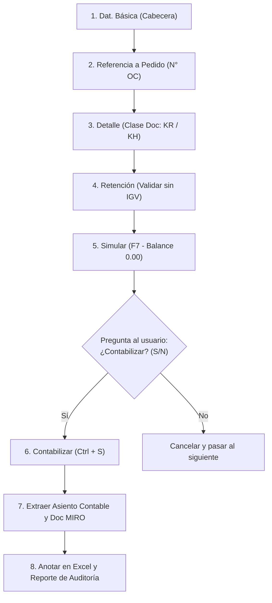

# 📑 GUÍA DE AUTOMATIZACIÓN SAP MIRO (BOT DE REGISTRO EN LOTE)

Esta guía describe el funcionamiento del **Bot Automático para SAP MIRO**, diseñado para procesar y contabilizar comprobante por comprobante (Facturas y Recibos por Honorarios) a partir del archivo maestro **`Masivo Reporte.xlsx`**, cumpliendo con el flujo oficial de 5 pantallas y capturando el Asiento Contable generado.

---

## 🖥️ Flujo Paso a Paso en SAP MIRO (5 Pantallas)



---

### 1️⃣ Pantalla 1: Pestaña `Dat.básic.`
| Campo SAP | Origen en Excel | Regla / Manejo Técnico |
|---|---|---|
| **Fecha factura** (`BLDAT`) | Columna B (`Fecha Doc`) | Se digita exactamente como viene en el Excel (ej. `21.09.2026`). |
| **Fecha contab.** (`BUDAT`) | Columna B (`Fecha Doc`) | Misma fecha del comprobante. |
| **Referencia** (`XBLNR`) | Columna D (`REFERENCIA`) | `01-0...` (Factura) o `02-0...` (Recibo por Honorarios). |
| **Importe** (`WRBTR`) | Columna Q (`Importe MD`) | Monto con 2 decimales (**Importe Total con IGV** para Facturas; Neto para RH). |
| **Moneda** (`WAERS`) | Constante `PEN` | **Solución técnica**: El bot asigna `PEN` mediante el objeto COM nativo de SAP (`ctxtINVFO-WAERS`). Si el campo viene bloqueado, utiliza la propiedad `.key = "PEN"`. |
| **Cal. Impuestos** (`MWSKZ` / `XMWST`) | Columna H (`Ind Impto`) | **Solución técnica**: Al ser un ComboBox no editable con teclado regular, el bot selecciona el ítem por su clave interna: `.key = "C1"` (Factura con IGV 18%) o `.key = "C0"` (RH Inafecto). Además, activa automáticamente la casilla `☑ Calc.Impuestos` cuando es `C1`. |
| **Texto** (`BKTXT`) | Columna L (`Texto Posición`) | **Filtro de servicio**: Se limpia la mención de la semana (ej. `SERVICIO DE SANEO SEMANA 38` se reduce a `SERVICIO DE SANEO`). |
| **Pedido/Plan entregas** (`EBELN`) | Columna U (`N° OC`) | Se digita el número de OC y se envía `[Enter]` (`sendVKey 0`). Esto carga las posiciones del pedido y enciende el semáforo verde con **`Saldo 0.00 PEN`**. |

---

### 2️⃣ Pantalla 2: Pestaña `Detalle`
- El bot hace clic en la pestaña `Detalle` (`tabpTAB_DETAIL`).
- En el campo **Clase doc.** (`BLART`):
  - **`KR` (Factura acreedor)**: Si el comprobante es Factura (`01-`).
  - **`KH`**: Si el comprobante es Recibo por Honorarios (`02-`).

---

### 3️⃣ Pantalla 3: Pestaña `Retención`
- El bot abre la pestaña `Retención` (`tabpTAB_WT`).
- Si es **Recibo por Honorarios**: No agrega ninguna retención.
- Si es **Factura**: Deja vacía la retención de IGV.

---

### 4️⃣ Pantalla 4: Ventana de Simulación
- El bot presiona el botón **Simular** (`F7` o `btn[7]`).
- Se abre la ventana modal emergente **`Simular documento en PEN`**, validando que el debe y haber cuadren a `0.00`.
- **Interacción de Control**: En la consola de Windows, el bot le pregunta al usuario:
  ```text
  👉 Revisa la simulación en tu SAP GUI.
  ❓ ¿Los datos están correctos y deseas CONTABILIZAR? (S/n):
  ```
- Si respondes `S` (o Enter), procede a guardar. Si respondes `N`, cancela y avanza a la siguiente fila.

---

### 5️⃣ Pantalla 5: Contabilización y Extracción de Asientos
- El bot presiona **Guardar** (`Ctrl + S` o `btn[11]`).
- SAP emite en la barra inferior el mensaje de éxito oficial:
  > *"Se ha contabilizado el documentoc de factura **5105773695** ( Asiento contable: **4300035763** )"*
- El bot extrae con expresiones regulares:
  1. **N° Factura MIRO**: `5105773695`
  2. **Asiento Contable FI**: `4300035763`
- Registra ambos números en las columnas **W** y **X** de `Masivo Reporte.xlsx` y genera el archivo independiente **`Reporte_Asientos_Contables_SAP.xlsx`**.

---

## 🚀 Cómo Ejecutar el Bot

### Opción A: Modo Interactivo (Recomendado para revisión paso a paso)
Pregunta al usuario después de cada simulación antes de realizar la contabilización real en SAP:
```bash
python scripts/1_sap_miro_scripting.py
```

### Opción B: Modo Automático en Lote (Para procesamiento masivo desatendido)
Procesa todas las filas seguidas de inicio a fin sin pausar:
```bash
python scripts/1_sap_miro_scripting.py --auto
```

### Opción C: Modo Simulación / Demo (100% Seguro, no guarda nada)
Rellena todos los campos, va a Detalle, Retención y presiona Simular para probar que el saldo cuadre en 0.00, pero **no contabiliza en SAP**:
```bash
python scripts/1_sap_miro_scripting.py --simular
```

---

## 📁 Archivos de Salida Generados

1. **`Masivo Reporte.xlsx`**: Se actualiza con 3 nuevas columnas al final de cada fila:
   - **Columna V**: `Estado MIRO` (`CONTABILIZADO`)
   - **Columna W**: `N° Factura MIRO` (ej. `5105773695`)
   - **Columna X**: `Asiento Contable` (ej. `4300035763`)

2. **`Reporte_Asientos_Contables_SAP.xlsx`**:
   - Archivo de auditoría independiente que contiene la relación clara:
   - `[Hoja, Fila, Fecha, REFERENCIA, RUC, N° OC, Servicio, Importe, Clase Doc, Ind Impto, N° Factura MIRO, Asiento Contable, Estado]`.
