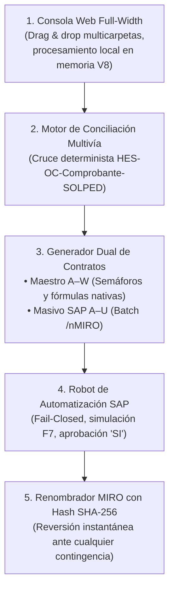

# 🏭 CaleraReport — Enterprise Document Automation & SAP Integration

> **Categoría:** Data Engineering · Workflow Automation · Financial Controls · SAP Integration  
> **Estado del Despliegue:** Producción Vercel Ready · Commit `3815081` (Baseline v3.0 `e7bde02`)  
> **Enlaces:** [Repositorio GitHub](https://github.com/LuisRomero20/CaleraReport) · [Aplicación Web](https://calerareport-ten.vercel.app)

---

## 📌 Ficha Ejecutiva del Proyecto

| Dimensión | Detalle / Métrica Verificada |
|---|---|
| **Empresa / Caso** | Sociedad Agrícola La Calera (Sociedad SAP 1001) |
| **Sedes Atendidas** | Arequipa, Chiclayo, Chimbote, Ica (4 sedes provinciales) |
| **Volumen Semanal** | 24 – 60 expedientes de pago a contratistas por período |
| **Tiempo de Proceso** | Reducido de **4-6 horas semanales** a **3.8 segundos** |
| **Arquitectura** | 100% Local / Zero-Cloud Leak / Zero-CDN Offline |
| **Pruebas Automatizadas** | 21 pruebas unitarias y de integración (100% aprobadas en 4.06s) |
| **Seguridad SAP** | Política Fail-Closed con confirmación afirmativa obligatoria ("SI") |
| **Integridad de Archivos** | Renombrado masivo con bitácora criptográfica y reversión por SHA-256 |

---

## 🎯 El Desafío Operativo

La gestión semanal de pagos a proveedores de servicios descentralizados en La Calera presentaba 4 graves problemas:
1. **Dispersión:** Facturas y Recibos por Honorarios llegando por correos desordenados con formatos heterogéneos.
2. **Conciliación Manual:** Necesidad de cruzar cada PDF con reportes de SAP (`ME5A`, `ME2N`, `ML84`) manualmente en Excel.
3. **Errores Fiscales:** Confusión frecuente entre el *Valor Venta* y el *Importe Total* en facturas con IGV, o deducciones de 4ta categoría en recibos por honorarios.
4. **Digitación Lenta en SAP MIRO:** Transcribir campo por campo en 5 pantallas por cada comprobante consumía entre 4 y 6 horas hombre por analista cada lunes.

---

## 💡 La Solución Implementada

CaleraReport Enterprise articula un ecosistema completo de 5 módulos locales:

---

## 📊 Métricas de Impacto Medidas y Verificables

* **⏱️ Tiempo por Expediente:** De ~6 minutos manual a **0.15 segundos** automatizado (**97.5% de ahorro**).
* **🎯 Tasa de Extracción y Conciliación:** **100% verificada** sobre el lote de 4 provincias (24 expedientes, 81 PDFs sintéticos).
* **🔒 Seguridad Financiera:** Cero falsos positivos en SAP; ninguna contabilización sin confirmación explícita y número de documento contable inequívoco.
* **⚡ Velocidad de Pruebas Unitarias:** De 28.68s a **4.06s** (86% más rápido) con ejecución reproducible en CI/CD (GitHub Actions).
* **🛡️ Privacidad Total:** Cero fuga de datos confidenciales hacia la nube (Cumplimiento Ley N° 29733).

---

## 🛠️ Stack Tecnológico Utilizado

* **Frontend:** HTML5, CSS3 Grid/Flexbox moderno, JavaScript ES2022 Vanilla (sin frameworks pesados), File System Access API.
* **Motores Documentales Locales:** `PDF.js` (Apache 2.0), `pypdf`, `reportlab`.
* **Procesamiento de Libros Excel:** `openpyxl` (fórmulas y formato condicional XML), `xlsx-js-style` (MIT), `JSZip` (MIT).
* **Automatización RPA y ERP:** SAP GUI Scripting (`win32com.client`), VBScript nativo Windows, `pyautogui` / `pywinauto` (Plan B de contingencia).
* **Seguridad y Criptografía:** `hashlib` (SHA-256), validaciones regex de documentos tributarios SUNAT.
* **DevOps y QA:** GitHub Actions, Python `unittest` con mocks COM, despliegue estático en Vercel.

---

## 📋 Entregables Oficiales Disponibles en el Repositorio

1. `Control_Ordenes_Servicio_Semana_XX.xlsx`: Libro de control A–W con 3 hojas (`BD`, `RESUMEN`, `INCIDENCIAS`) y semáforos condicionales verde/amarillo/rojo.
2. `Masivo Reporte.xlsx`: Plantilla A–U formateada para carga masiva directa en `/nMIRO`.
3. `Reporte_Asientos_Contables_SAP.xlsx`: Bitácora generada por el robot con N° de Factura MIRO y Asiento Contable extraídos de SAP.
4. `Renombrar_Documentos_MIRO.bat`: Script ejecutable en Windows para renombrado seguro con un solo clic.
5. Suite de documentación técnica empresarial (`docs/01` al `docs/12`).
